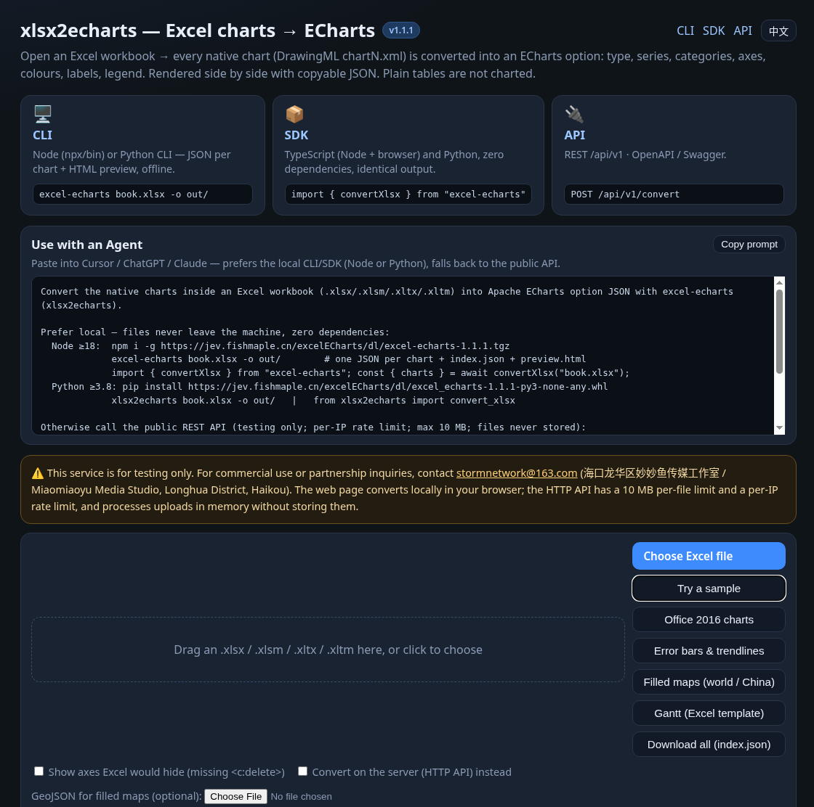
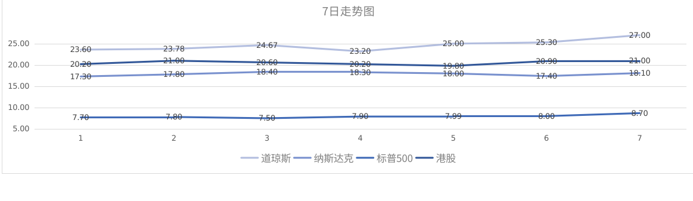
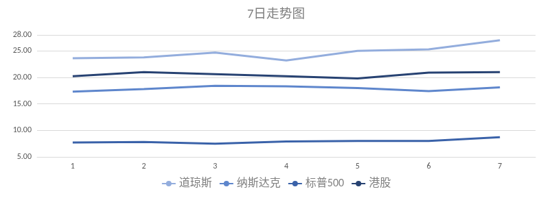
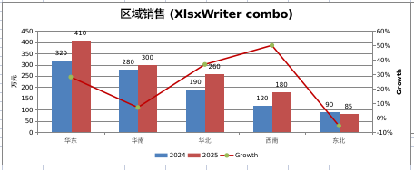
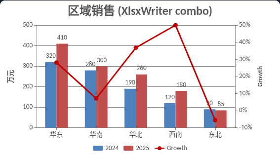

<div align="center">

**English** · [简体中文](README.zh-CN.md)

# excel-chart-echarts

**Converts embedded native Excel charts (DrawingML) into Apache ECharts options — not arbitrary sheet data → charts. TypeScript & Python, zero Excel runtime deps, Node + browser.**

Open-source DrawingML → ECharts converter with **CLI**, **SDK**, and **REST API** built in, plus a web demo that converts locally by default.

[](ts/package.json)
[](LICENSE)
[](ts/package.json)
[](pyproject.toml)
[](https://jev.fishmaple.cn/excelECharts/?lang=en)



</div>

## Get started — CLI · SDK · API

Three equal ways into the same converter. Pick one:

### CLI — local convert, no server

```bash
# Node (from GitHub Release)
npm i -g https://github.com/fishstormX/excel-chart-echarts/releases/download/v1.0.0/excel-chart-echarts-1.0.0.tgz
excel-chart-echarts book.xlsx -j -o out.json          # one-shot JSON
excel-chart-echarts book.xlsx -o out/                 # full export + preview.html

# Python (from GitHub Release)
pip install https://github.com/fishstormX/excel-chart-echarts/releases/download/v1.0.0/excel_chart_echarts-1.0.0-py3-none-any.whl
xlsx2echarts book.xlsx -j -o out.json
xlsx2echarts book.xlsx -o out/
```

`-j` / `--json` writes a single JSON (stdout if you omit `-o`). Full `-o out/` mode still writes one JSON per chart + `index.json` + `preview.html`.

### SDK — TypeScript & Python

```ts
import { convertXlsx, prepare } from "excel-chart-echarts";
const { charts } = await convertXlsx("book.xlsx");
echarts.init(el).setOption(prepare(charts[0].option));
```

```python
from xlsx2echarts import convert_xlsx
res = convert_xlsx("book.xlsx")
# res["charts"][i]["option"] → ECharts option
```

### API — REST `/api/v1/*`

```bash
curl -s -F file=@book.xlsx https://jev.fishmaple.cn/excelECharts/api/v1/convert
```

→ [In-site docs](https://jev.fishmaple.cn/excelECharts/api.html) · [Swagger](https://jev.fishmaple.cn/excelECharts/api/docs)

> Public API is **for testing only**. Commercial / partnership: [stormnetwork@163.com](mailto:stormnetwork@163.com).

## Features

- **Native Excel charts only** — reads DrawingML charts already embedded in `.xlsx` / `.xlsm` / `.xltx` / `.xltm` (not plain tables).
- **Broad type coverage** — bar / line / area / pie / doughnut / scatter / bubble / radar / combo + secondary axis; error bars & trendlines; Office 2016+ chartEx (waterfall, treemap, sunburst, histogram, Pareto, funnel, box-whisker, region map).
- **Zero Excel runtime deps** — no openpyxl / ExcelJS / Office automation at convert time.
- **TS ≡ Python** — identical JSON for the same file (`tests/parity.py`).
- **Node + browser** — same package; browser uses `DecompressionStream`.
- **Theme-aware colors** — `theme1.xml` accents, fills, lines, label formats.
- **Privacy-first demo** — browser-local by default; API uploads stay in memory.
- **Bilingual UI** — English / 中文 (`?lang=en` / `?lang=zh`).

## Live demo

👉 **[https://jev.fishmaple.cn/excelECharts/?lang=en](https://jev.fishmaple.cn/excelECharts/?lang=en)** · [中文](https://jev.fishmaple.cn/excelECharts/?lang=zh) · [API guide](https://jev.fishmaple.cn/excelECharts/api.html)

Try built-in samples on the page (*Try a sample*, *Office 2016 charts*, *Error bars*, *Maps*, *Gantt*).

## Results

Left = chart as opened in a spreadsheet (WPS Spreadsheets, English UI). Right = same workbook through excel-chart-echarts.

### Line chart

Source: [`examples/line-chart.xlsx`](examples/line-chart.xlsx)

| Excel / WPS | excel-chart-echarts |
|---|---|
|  |  |

### Combo · secondary axis

Source: [`examples/combo-secondary-axis.xlsx`](examples/combo-secondary-axis.xlsx)

| Excel / WPS | excel-chart-echarts |
|---|---|
|  |  |

More side-by-side cases (error bars, multi-level categories, Gantt, MS templates, chartEx, maps): **[docs/more-examples.md](docs/more-examples.md)**.

## Coverage & fidelity

What we use as the project benchmark: **visual fidelity** vs Excel/WPS on real workbooks, plus **TypeScript ≡ Python** output.

| Check | Status |
|---|---|
| Classic DrawingML chart groups (bar/line/area/pie/scatter/radar/bubble/combo) | Supported |
| Secondary axis / multi-axis combo | Supported |
| Error bars (`c:errBars`) + trendlines | Supported (`prepare()` required for custom renderers) |
| Office 2016 chartEx (waterfall / treemap / sunburst / hist / Pareto / funnel / box / regionMap) | Supported |
| Theme colors + number formats | Supported (common format subset) |
| Formula cache missing (openpyxl / pandas style) | Cell + small evaluator fallback |
| TypeScript output ≡ Python output | `tests/parity.py` on fixtures |
| `.xls` / `.xlsb` | Not supported (OOXML only) |
| Pixel-identical layout / fonts | Approximate (ECharts ≠ Excel layout engine) |

How it works internally: **[docs/architecture.md](docs/architecture.md)**.

## Quickstart

### Install

```bash
# GitHub Release v1.0.0
npm i https://github.com/fishstormX/excel-chart-echarts/releases/download/v1.0.0/excel-chart-echarts-1.0.0.tgz
pip install https://github.com/fishstormX/excel-chart-echarts/releases/download/v1.0.0/excel_chart_echarts-1.0.0-py3-none-any.whl
```

From a clone:

```bash
git clone https://github.com/fishstormX/excel-chart-echarts.git
cd excel-chart-echarts/ts && npm i && npm run build
cd ../ && pip install -e .
```

### Convert one file

```bash
excel-chart-echarts book.xlsx -j -o out.json   # JSON only
excel-chart-echarts book.xlsx -o out/          # full export; open out/preview.html
```

### Library

```ts
import { convertXlsx, prepare } from "excel-chart-echarts";
const { charts, warnings } = await convertXlsx(file); // path | Uint8Array | Blob
for (const c of charts) {
  echarts.init(document.getElementById(c.name)!).setOption(prepare(c.option));
}
```

```python
from xlsx2echarts import convert_xlsx
print(convert_xlsx("book.xlsx")["charts"][0]["types"])
```

### Local API / web UI

```bash
# with API extras
pip install -e ".[api]"
uvicorn app.main:app --port 8765
```

## API

| Route | Description |
|---|---|
| `POST /api/v1/convert` | multipart `file` → charts + options JSON |
| `GET /api/v1/health` | health / version |
| `/api/docs` | Swagger |

Env (defaults): `X2E_RATE_LIMITS=3/10s,20/60s`, `X2E_MAX_MB=10`, `X2E_MAX_UNZIPPED_MB=150`, `X2E_TIMEOUT_S=30`, `X2E_BASE_PATH`, `X2E_SERVE_UI`, `X2E_TRUSTED_PROXIES`.

## Docs

| Doc | Contents |
|---|---|
| [CI/CD](https://github.com/fishstormX/excel-chart-echarts/actions/workflows/ci.yml) | Build + parity on `main` / PRs; pack npm/wheel on `v*` tags (GitHub Release) |
| [GitHub Releases](https://github.com/fishstormX/excel-chart-echarts/releases) | Packaged `.tgz` (npm) + `.whl` (pip) — built by Actions on `v*` tags |
| [Architecture](docs/architecture.md) | Pipeline, OOXML mapping, TS/Python parity, hooks |
| [examples/](examples/) | Sample `.xlsx` / `.xltx` workbooks used in the gallery |
| [More examples](docs/more-examples.md) | Extended Excel vs ECharts gallery |
| [中文 README](README.zh-CN.md) | Same page in Chinese |

## Tests

```bash
python3 tests/gen_samples.py fixtures && python3 tests/gen_fixtures_extra.py fixtures
python3 tests/gen_errbars.py fixtures && python3 tests/gen_chartex.py fixtures
(cd ts && npm i && npm run build)
python3 tests/parity.py
```

## Known limitations

- Layout and fonts are approximate; colors, data, chart types, axes, labels and legends aim to match Excel.
- 3D charts render as 2D; `stockChart` / `surfaceChart` degrade to lines; images/shapes inside charts are skipped.
- Number formats: common subset only. Formula evaluator: common functions only.
- `regionMap`: world + China provinces or custom GeoJSON (no Bing geocoding). Publishing maps in mainland China may require a surveying license.
- openpyxl ≥3.1 charts without axis ticks follow Excel’s hidden-axis rule (`--show-missing-axes` / `excelCompat:false` to override).

## License

[MIT](LICENSE) © 妙妙鱼 / fishstormX

## Acknowledgements

[Apache ECharts](https://echarts.apache.org/) · [ECMA-376 OOXML](https://www.ecma-international.org/publications-and-standards/standards/ecma-376/) · [FastAPI](https://fastapi.tiangolo.com/)
