# More examples

Side-by-side fidelity shots: **Excel / WPS** (left) vs **excel-echarts** (right).  
The main [README](../README.md) only shows two basics; this page is the rest of the gallery.

Live demo: [English](https://jev.fishmaple.cn/excelECharts/?lang=en) · [中文](https://jev.fishmaple.cn/excelECharts/?lang=zh)

> Spreadsheet crops were taken in WPS Spreadsheets (English UI). Office 2016 **chartEx** types (waterfall, treemap, …) and some filled maps show as “unavailable” in WPS — for those we show the ECharts output only.

---

## Combo · secondary axis (openpyxl)

Bar + line on a secondary value axis — a common Excel pattern.

| Excel / WPS | excel-echarts |
|---|---|
| 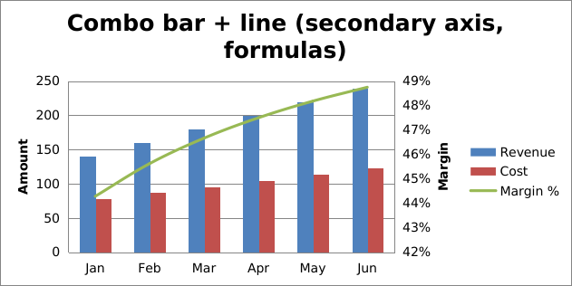 | 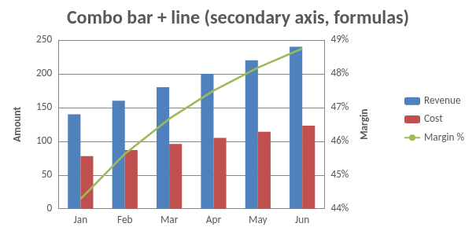 |

---

## Error bars · trendlines

Custom / percentage / stdDev error bars and several trendline kinds (linear, exp, poly, moving average).

| Excel / WPS | excel-echarts |
|---|---|
| 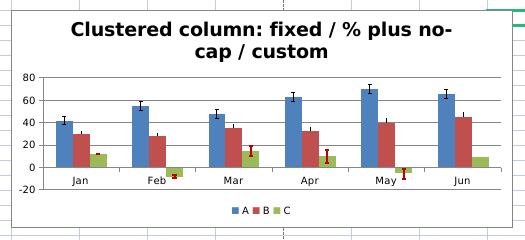 | 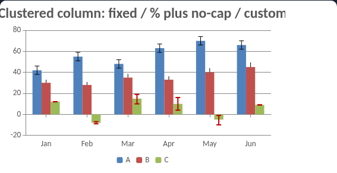 |

---

## Multi-level categories · 100% stacked

Nested category labels and percent-stacked series (edge cases from XlsxWriter).

| Excel / WPS | excel-echarts |
|---|---|
| 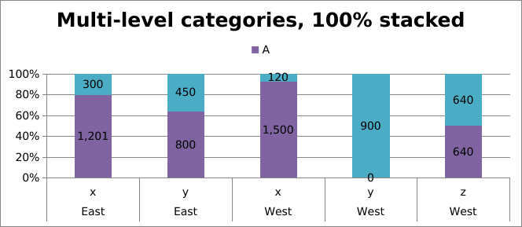 | 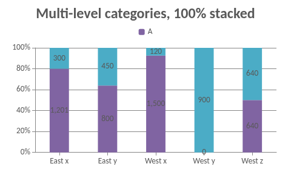 |

---

## Gantt-style bars

Category timeline rendered as a horizontal bar chart.

| Excel / WPS | excel-echarts |
|---|---|
| 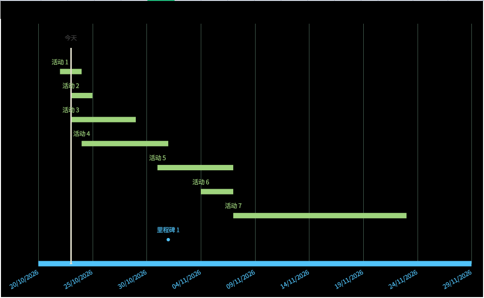 | 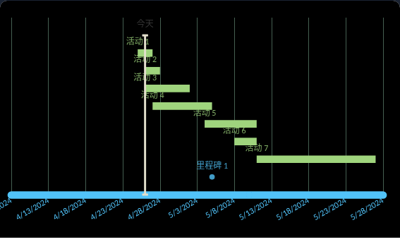 |

---

## Microsoft templates

Pareto, funnel, and regional sales samples from Office-style templates.

### Pareto

| Excel / WPS | excel-echarts |
|---|---|
| 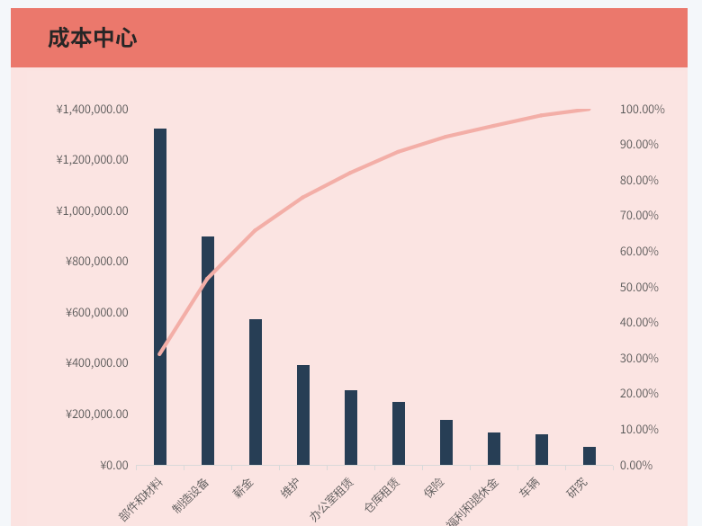 | 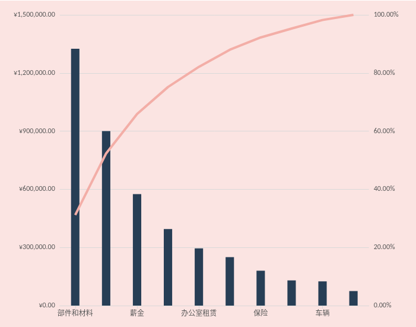 |

### Funnel

| Excel / WPS | excel-echarts |
|---|---|
| 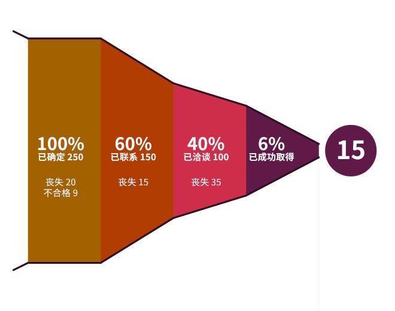 | 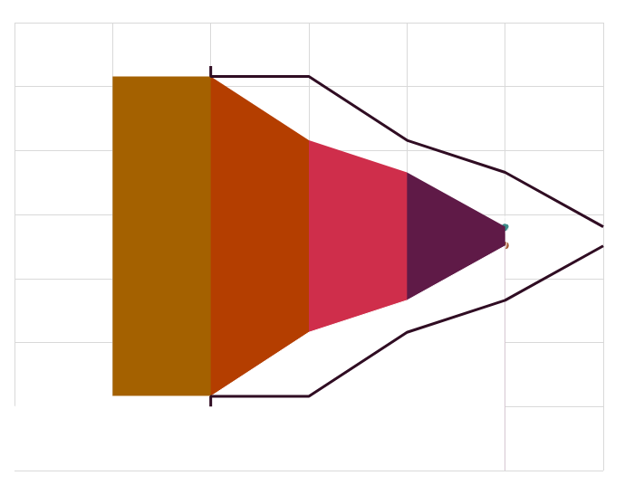 |

### Regional sales

| Excel / WPS | excel-echarts |
|---|---|
| 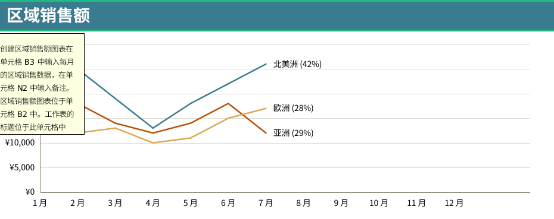 | 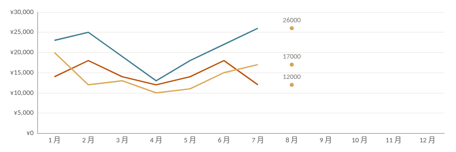 |

---

## Office 2016 chartEx (ECharts side)

These live in `xl/charts/chartExN.xml`. WPS often cannot render them; excel-echarts maps them to native ECharts types.

| Waterfall | Treemap | Sample pack |
|---|---|---|
| 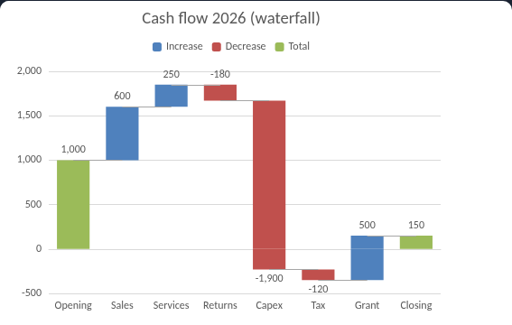 | 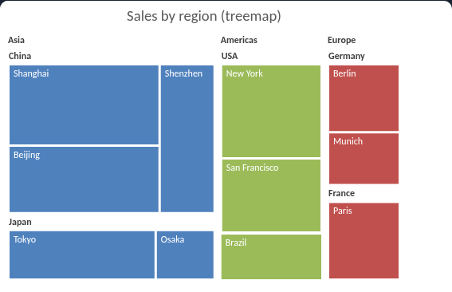 | 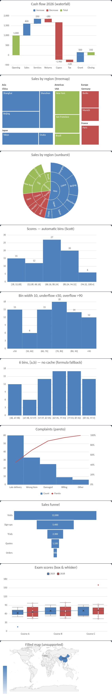 |

---

## Filled map

World region map → ECharts `map` + `visualMap` (built-in world / China province GeoJSON, or your own).

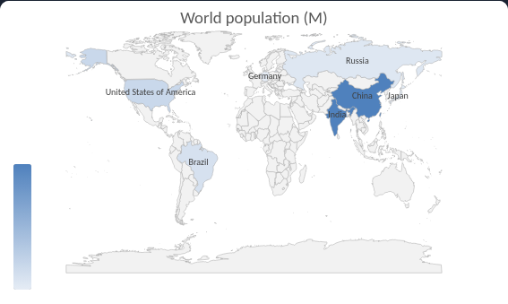

---

## Full workbook sheets (optional reference)

Whole-sheet composites used while building the gallery:

| openpyxl sheet (Excel) | xlsxwriter sheet (Excel) | xlsxwriter sample (web) |
|---|---|---|
| 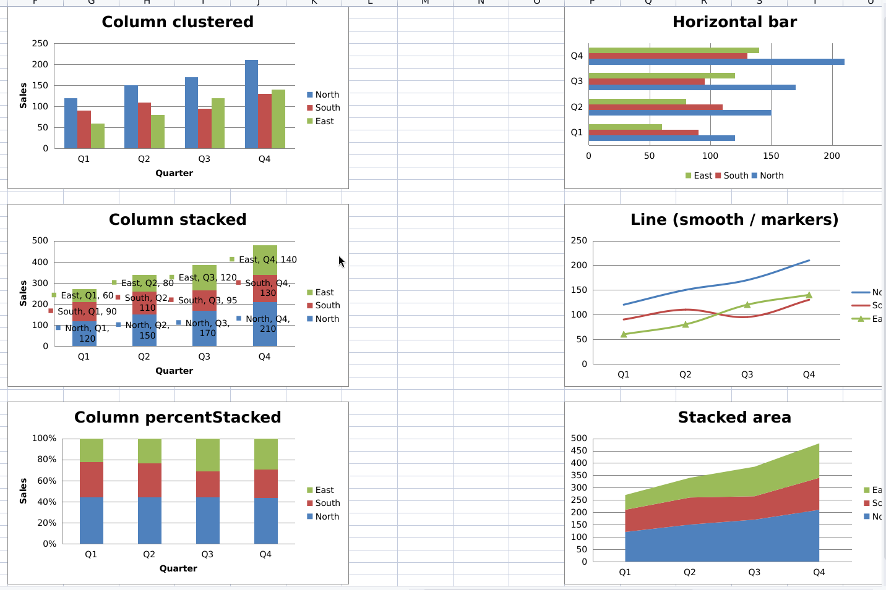 | 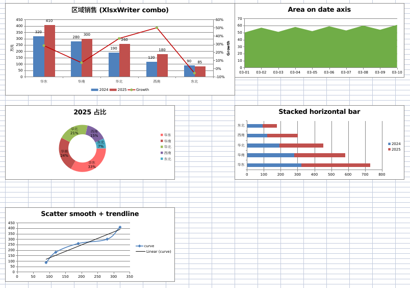 | 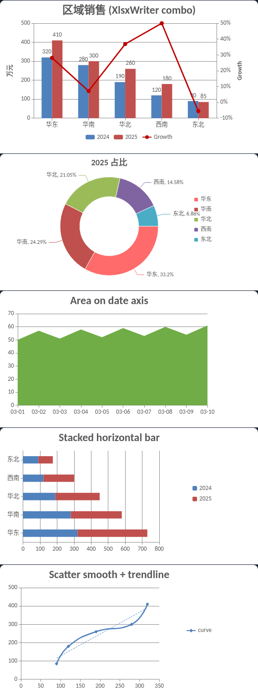 |

---

How conversion works: [Architecture](architecture.md) · Chinese: [更多样例](more-examples.zh-CN.md)
